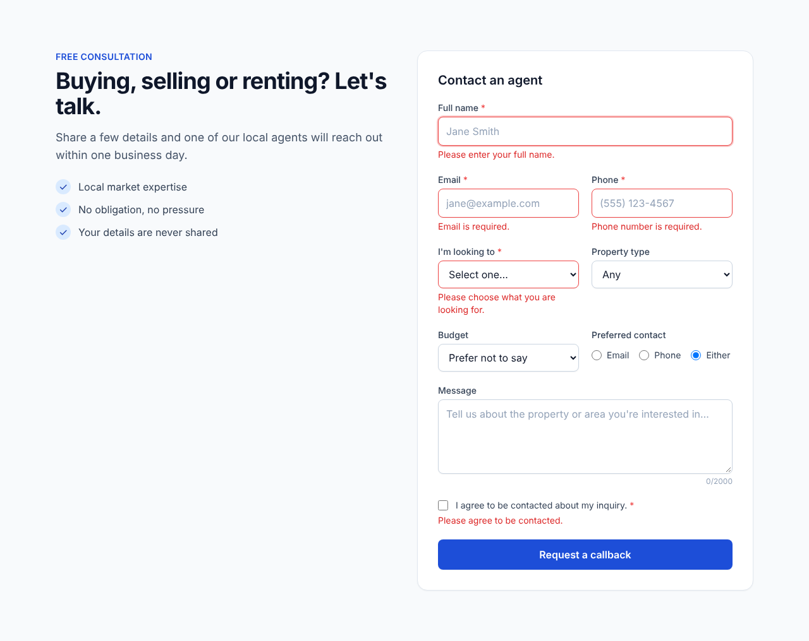
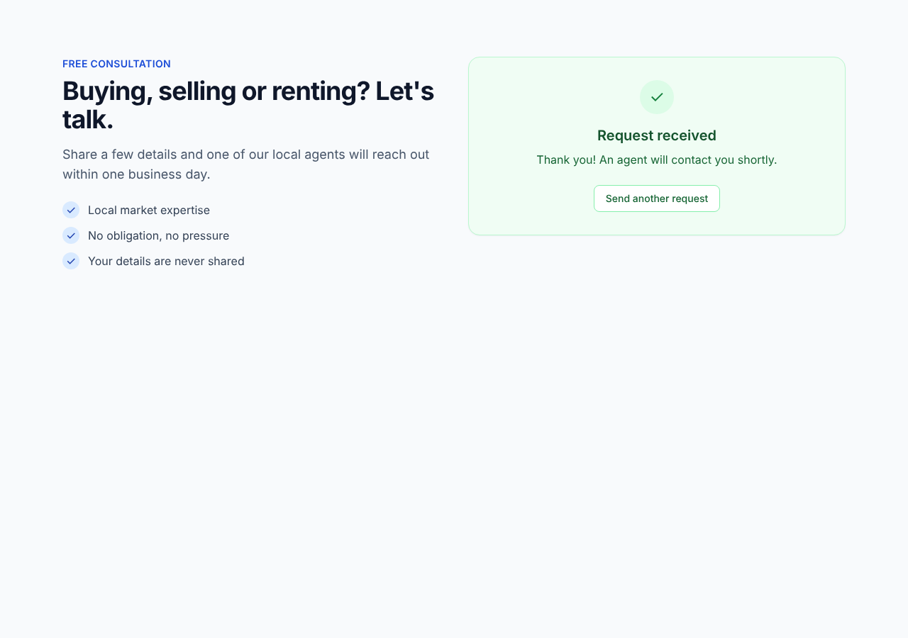
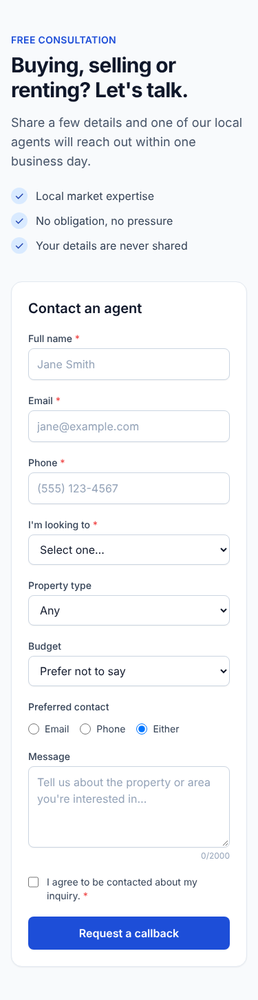

# Real Estate Lead Capture Form

A responsive lead capture form for a real estate website, built with **Next.js (App Router), React, JavaScript, Tailwind CSS**, a **Node.js API** with server-side validation and spam protection, **MySQL** storage and **automated email/webhook notifications**.

| Validation | Success | Mobile |
|---|---|---|
|  |  |  |

## How it works

```
LeadForm (React, client validation, honeypot, timestamp)
   │  POST /api/leads  (JSON)
   ▼
API route (Node.js runtime)
   1. content-type + 10 KB body-size guard
   2. rate limit per IP          → 429
   3. spam checks                → fake 200 (bot gets no signal)
   4. server-side validation     → 422 + per-field errors
   5. INSERT into MySQL          → 500 friendly message on failure
   6. notify: email to agent (+ optional auto-reply to lead) and/or webhook
   7. store notification_status on the lead row
   └─ 201 { success, message, id }
```

A failed notification never loses a lead: the row is saved first, and `notification_status` / `notification_error` record what happened so failed notifications can be found and re-sent.

## Project structure

| Path | Purpose |
|---|---|
| `components/LeadForm.jsx` | The form: inline validation, loading state, success & error messages, accessible (labels, `aria-invalid`, focus management) |
| `app/api/leads/route.js` | The API endpoint |
| `lib/validation.js` | Validation rules shared by client and server (server is the source of truth) |
| `lib/spam.js` | Honeypot, time trap, link/phrase heuristics |
| `lib/rateLimit.js` | Per-IP rate limiter |
| `lib/db.js` | MySQL connection pool + queries (parameterised, no SQL injection) |
| `lib/notify.js` | Email notifications (Resend API or any SMTP) + webhook |
| `db/schema.sql` | `leads` table |
| `tests/` | Unit, API and component tests (Vitest + Testing Library) |

## Setup

Requirements: Node.js 18.18+ (20/22 recommended), MySQL 5.7+ / 8.x (MariaDB 10.5+ also works).

```bash
npm install
cp .env.example .env.local      # then fill in values
```

Create the database and table:

```bash
mysql -u root -p -e "CREATE DATABASE real_estate CHARACTER SET utf8mb4;"
node --env-file=.env.local scripts/migrate.mjs     # or: mysql -u ... real_estate < db/schema.sql
```

Run:

```bash
npm run dev        # http://localhost:3000
npm test           # run the test suite
npm run build && npm start
```

## Notifications

Set `NOTIFY_PROVIDER` in `.env.local`:

| Value | What you need |
|---|---|
| `resend` | `RESEND_API_KEY` from resend.com and a verified sender domain for `NOTIFY_FROM` |
| `smtp` | `SMTP_HOST`, `SMTP_PORT`, `SMTP_USER`, `SMTP_PASSWORD` — works with SendGrid, Mailgun, Amazon SES, Postmark, Gmail/Workspace, etc. |
| `none` | Emails disabled (e.g. if you only use the webhook) |

- `NOTIFY_TO` — the agent/office inbox that receives new leads (the email's Reply-To is the lead, so the agent can reply directly).
- `NOTIFY_SEND_AUTOREPLY=true` — also send a confirmation email to the person who filled in the form.
- `LEAD_WEBHOOK_URL` — optional; every lead is POSTed as JSON here (Zapier, Make, a CRM, Slack workflow...).

## Spam protection

- **Honeypot** — hidden `website` field; bots fill it, people don't.
- **Time trap** — submissions sent less than `MIN_FILL_TIME_MS` (default 3 s) after the form loaded are rejected.
- **Content heuristics** — more than 2 links or common spam phrases are rejected.
- **Rate limit** — `RATE_LIMIT_MAX` submissions per IP per `RATE_LIMIT_WINDOW_MS` (default 5 per 10 min).

Blocked spam receives a normal-looking success response so bots can't tell they were caught.

Production notes:
- The rate limiter is in-memory, which is right for a single Node server. On serverless/multi-instance hosting (e.g. Vercel) swap it for Redis/Upstash — same `rateLimit(key, opts)` interface.
- The client IP is read from `X-Forwarded-For`. Run behind a proxy/host that sets this header (Vercel, Nginx, Cloudflare, etc.).
- If spam gets past these checks later, Cloudflare Turnstile or reCAPTCHA can be added in `lib/spam.js` without changing the form flow.

## Embedding in the existing site

Copy `components/LeadForm.jsx`, `lib/`, and `app/api/leads/` into the existing Next.js project, add the Tailwind component classes from `app/globals.css`, then render:

```jsx
import LeadForm from '@/components/LeadForm';

<LeadForm />                         // posts to /api/leads
<LeadForm endpoint="/api/leads" />  // or a custom endpoint
```

If the existing site uses the Pages Router, the handler logic in `app/api/leads/route.js` moves into `pages/api/leads.js` unchanged apart from the request/response wrapper.

## Testing

`npm test` runs 37 tests covering:
- validation rules (valid/invalid values, normalisation, injection-style inputs)
- spam checks and rate limiting
- notifications (Resend payload, auto-reply, webhook, failures don't throw, HTML escaping)
- the API route (201 / 422 / 429 / 400 / 413 / 415 / 500, spam silently dropped, lead kept when notification fails)
- the form component (client errors, success message, server field errors, network error)

The full workflow was also tested end to end in Chromium against a running server and database: form → API → database row → webhook notification, plus spam, validation and rate-limit checks against the live endpoint, and a mobile (375 px) layout check.
